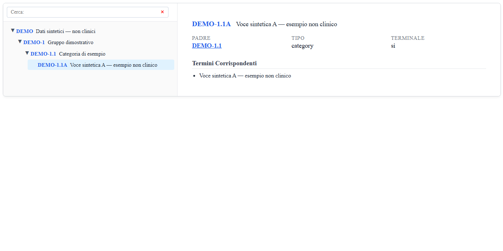
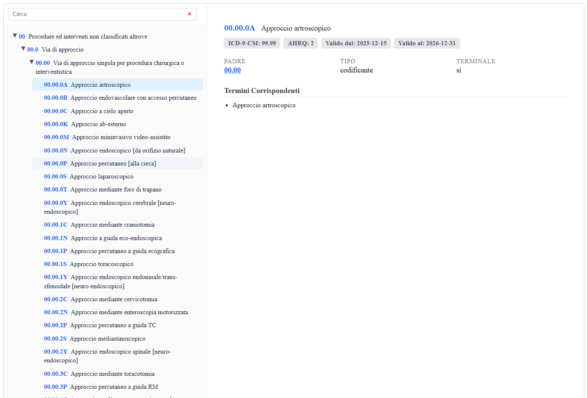

# Clinical Coding Platform

PHP REST APIs and embeddable JavaScript tools for browsing, searching and selecting codes from the Italian **ICD-10-IM** and **CIPI** classifications.

Developed by **[Federico Del Pup](https://github.com/FedeDP7)** as a thesis project, the platform brings classification data, hierarchical navigation and reusable coding interfaces together. Its design is inspired by the WHO ICD-11 architecture.

## Academic context

**Thesis title** — *Progettazione e sviluppo di una piattaforma per ICD-10-IM ispirata all’architettura ICD-11 dell’OMS: API REST e libreria JavaScript*

**Author:** Federico Del Pup

**Supervisor:** Prof. Vincenzo Della Mea

The thesis title and classification terminology are retained in Italian. This README presents the software in English; detailed technical documentation is also available in Italian.

## What the platform provides

- **Data conversion:** Excel workbooks are converted into indexed JSON datasets.
- **REST APIs:** release information, entity details, parent/child navigation, full subtree searches and ICD-9-CM crosswalks.
- **JavaScript integration:** reusable search fields, hierarchy browsers, popups and selection callbacks through the `ICT` / `CODIT` aliases.
- **ICD-10-IM coding workflows:** dagger/asterisk associations and SDO integration examples.
- **Working examples:** browser, callback, coding tool, popup and SDO demos, plus multiple instances in the main component.

## Demo previews

### ICD-10-IM

Hierarchy browser and details for a selected ICD-10-IM code.



Classification content: Ministero della Salute and Regione Autonoma Friuli Venezia Giulia, ICD-10-IM gamma 2.1 (December 2025), [CC BY-NC-ND 4.0](https://creativecommons.org/licenses/by-nc-nd/4.0/). [Full attribution and source](docs/DATA_SOURCES.md#icd-10-im).

### CIPI

The standalone CIPI browser uses the same interaction patterns for procedure codes.



Classification content: Ministero della Salute, CIPI gamma 2.0 (December 2025), [CC BY-NC-ND 4.0](https://creativecommons.org/licenses/by-nc-nd/4.0/). [Full attribution and source](docs/DATA_SOURCES.md#cipi).

Screenshots show the local demo interfaces using classification data; no patient records are used.

## Repository components

| Directory | Purpose | Documentation |
| --- | --- | --- |
| `icd10-im/` | Main platform: shared API for ICD-10-IM and CIPI, with libraries and integration examples. | [Setup](icd10-im/README.md) · [Italian technical documentation](icd10-im/docs/README.it.md) |
| `cipi/` | Standalone CIPI implementation with its own API, library and examples. | [Setup](cipi/README.md) · [Italian technical documentation](cipi/docs/README.it.md) |
| `tests/` | API and hierarchy regression tests using synthetic fixtures. | [Run the tests](#regression-tests) |

The main platform already supports CIPI. The separate `cipi/` component preserves its standalone implementation; the two components can be run independently. Each keeps its existing internal paths.

## Requirements

- **PHP 8.1 or later**, with `ZipArchive`, `SimpleXML` and `mbstring` enabled.
- A modern browser supporting Fetch and AbortController.
- **Optional:** Node.js for the standalone CIPI converter.

No Composer or npm dependency installation is required for these components.

## Run locally

### 1. Clone the repository

```sh
git clone https://github.com/FedeDP7/clinical-coding-platform.git
cd clinical-coding-platform
```

### 2. Supply the classification data

**Workbooks and generated JSON files are not included in Git.** Obtain authorized source workbooks before running the data-backed demos. The expected locations are:

| Component / dataset | Source workbook | Generated data |
| --- | --- | --- |
| Main platform / ICD-10-IM | `icd10-im/api/data/icd10im.xlsx` | `icd10-im/api/data/icd10im.json` |
| Main platform / CIPI | `icd10-im/api/data/CIPI.xlsx` | `icd10-im/api/data/cipi.json` |
| Standalone CIPI | `cipi/api/data/CIPI.xlsx` | `cipi/api/data/cipi.json` |

Only the workbooks for the component and dataset you intend to use are needed. See the [main platform data instructions](icd10-im/api/data/README.md) and [standalone CIPI data instructions](cipi/api/data/README.md). Without imported data, the API returns HTTP 503 with `DATA_NOT_READY`.

### 3. Start the main platform

Run these commands from the repository root after supplying the corresponding workbooks:

```sh
php icd10-im/scripts/convert.php icd10-im/api/data/icd10im.xlsx icd10-im/api/data/icd10im.json
# Also generate CIPI data if you want to use the CIPI examples:
php icd10-im/scripts/convert_cipi.php icd10-im/api/data/CIPI.xlsx icd10-im/api/data/cipi.json
php -S localhost:8000 -t icd10-im
```

Open `http://localhost:8000/index.html` for the ICD-10-IM examples. The CIPI browser is available at `http://localhost:8000/Samples_CIPI/Browser/browser.html`.

### 4. Alternatively, start standalone CIPI

Stop the previous server, then run from the repository root:

```sh
php cipi/scripts/convert_cipi.php cipi/api/data/CIPI.xlsx cipi/api/data/cipi.json
php -S localhost:8000 -t cipi
```

Open `http://localhost:8000/Web/cipi.html` or `http://localhost:8000/Samples/Browser/browser.html`.

The CIPI examples default to port 8000. To run both components simultaneously, use different ports and adjust the relevant `apiBaseUrl` settings. The PHP built-in server is used here for local development.

## Regression tests

From the repository root:

```sh
php tests/regression.php
```

The suite uses synthetic fixtures and does not require classification datasets. It covers query parameter validation, pagination, descendant filters, chapter interval aliases and hierarchy normalization. API and hierarchy corrections are documented in [docs/FIXES.md](docs/FIXES.md).

## Data handling and licensing

ICD-10-IM import preserves source clinical fields, retains chapter intervals as metadata and adds two explicitly marked, non-codable technical range containers for navigation. CIPI PHP and Node conversion outputs differ only in line-ending normalization for 19 source entities. See the [correction details](docs/FIXES.md).

Source code and accompanying software documentation are licensed under the **[MIT License](LICENSE)**. Classification datasets, classification content visible in screenshots and any thesis document are outside that license's scope. The supplied workbooks specify **CC BY-NC-ND 4.0**. See [sources, attribution and reuse conditions](docs/DATA_SOURCES.md), including the limits on sharing normalized datasets. Local workbooks and generated JSON remain ignored by Git.
